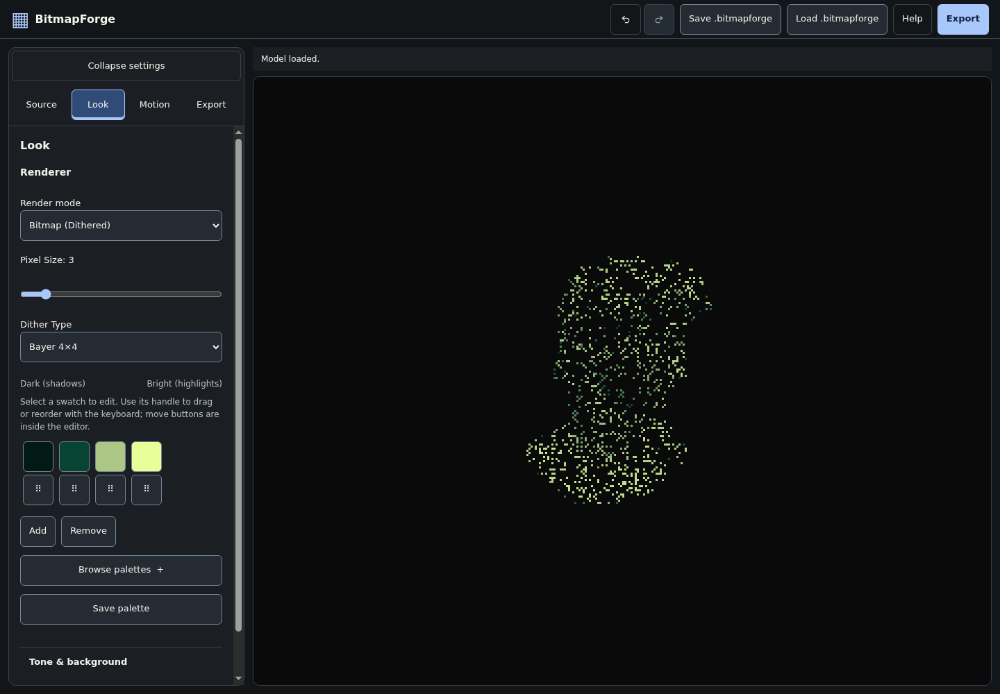
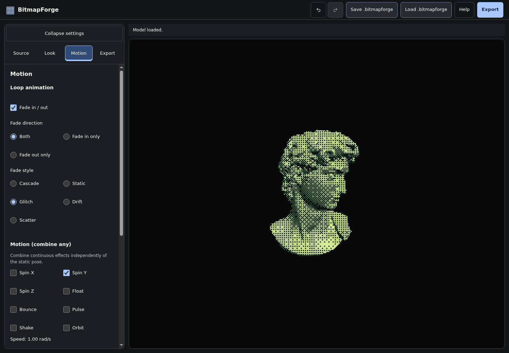
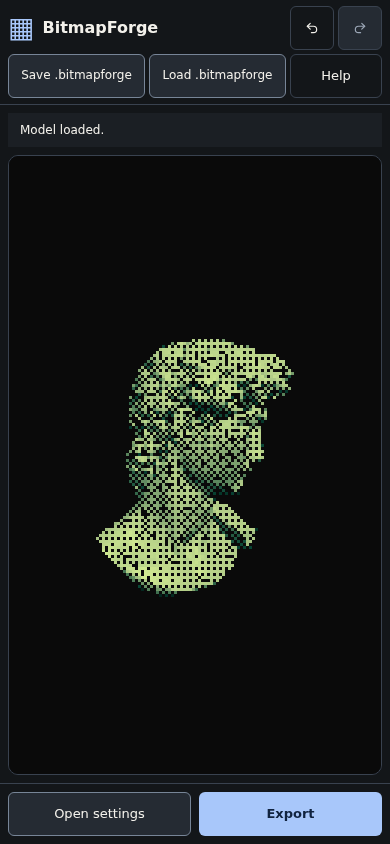
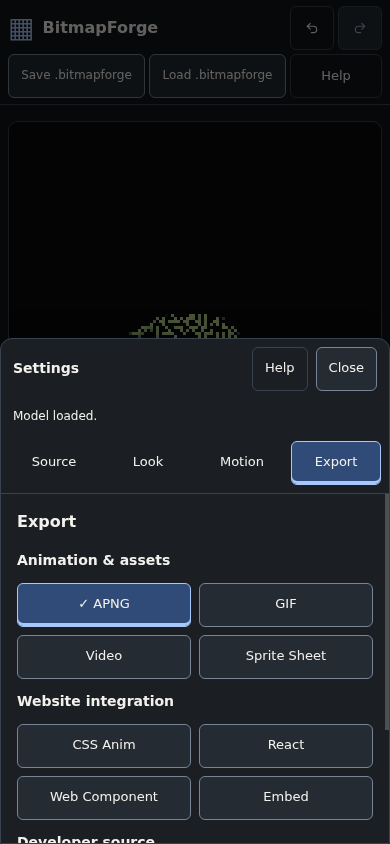

# Bitmap Workbench redesign

BitmapForge's working editor has been redesigned around the artwork and four freely selectable tasks: **Source, Look, Motion and Export**. This is an application redesign, not a marketing page or a new rendering engine.

## What changed

- A compact branded command bar with history, local project Save/Load, visible Help and persistent Export access.
- A calm graphite/cobalt visual system with consistent labelled native controls, selected markers, focus states and44px command targets.
- Task navigation replaces the endlessly expanded settings stack; state and the live preview/export controller survive navigation and responsive changes.
- All four source types are discoverable from the empty stage. Loaded files have compact, factual metadata and clearer Replace/Remove hierarchy.
- Renderer-first Look controls, directly available bitmap dithering, a current palette strip and optional complete palette browser. Palette saving is explicitly color-only.
- Meaningfully grouped motion/timing and static composition/light controls, retaining all existing values and capabilities.
- All nine output choices grouped by purpose; project persistence is separate from output generation.
- A bounded mobile bottom modal, with a full-height short/landscape fallback, explicit Preview/Close route, safe scrolling and preserved keyboard/focus behavior.

No new runtime dependencies, remote fonts, UI framework migration, cloud save, camera zoom, export format or project/preset schema change.

## Real screenshots

Captured from the implemented local app with the repository's existing demo model. Artwork animation phase can differ between images; these are not edited mockups.

### Desktop: Look

### Desktop: Motion

### Phone: preview

### Phone: export inspector

The phone inspector is modal/inert and may obscure most centered artwork; Close returns to full preview. This does not claim simultaneous full-artwork editing.

## Research, method and evidence

- [Research and source/skill provenance](research.md)
- [Design specification and capability inventory](specification.md)
- [State, focus, viewport and ownership contracts](state-contracts.md)
- [Implementation and nine-format verification plan](implementation-plan.md)
- [Independent plan acceptance](plan-acceptance.md)
- [Executed verification and limitations](verification.md)
- [Small baseline-relative response observation](performance-observation.md)

Two reviewed text-only design skills were installed in the maintainer's Gloin profile: an Anthropic frontend-design adaptation and a credited Unslop editor-redline adaptation, with licenses/provenance retained. Other requested skill/tool repositories were investigated; unnecessary installers, paid/upload services and runtime migrations were not added.

Independent foundation, source, palette, Look/motion/output, integration and bounded-fix audits are retained in this directory, including failures and their dispositions. Tests were adapted to the new navigation, not replaced by screenshots or weakened assertions. Physical-device/Safari/screen-reader/real-browser-menu zoom checks remain explicitly unverified.

## Git delivery

- Earlier verified work: branch `gloin/verified-ui-foundations`, commit `8c6613279ed856e4933608e7e6c04e91dca2b331`.
- Redesign: separate branch `gloin/editor-redesign`.
- No PR, merge or production deployment is included in this branch-only task.
